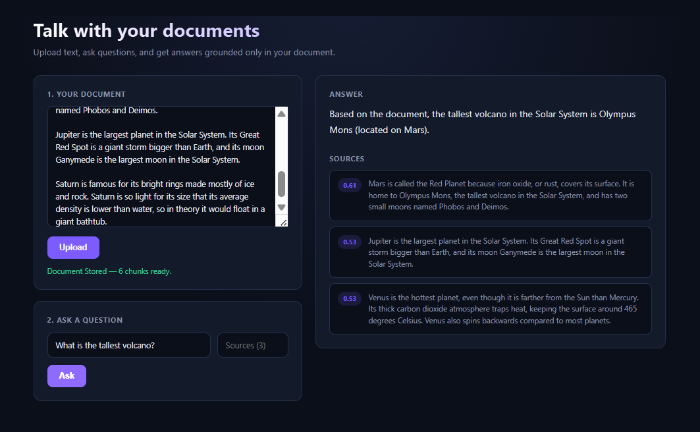
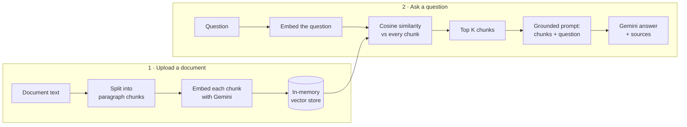

<!-- @format -->

# Chat With Your Document — RAG Full-Stack App

Paste in any document, ask questions about it, and get answers grounded **only** in that document, with the exact passages the answer came from and how closely each one matched.

The retrieval layer (chunking, embeddings storage, cosine similarity search, ranking) is written from scratch in plain JavaScript, without a vector database or RAG framework, to show how Retrieval-Augmented Generation works under the hood.

![App screenshot: a planets document on the left, the question "What is the tallest volcano?" and a grounded answer with ranked sources on the right]


## Features

- **Upload a document** — paste any text; it's split into paragraph chunks and embedded
- **Ask questions in natural language** — answers come only from your document
- **Grounded answers** — if the answer isn't in the document, the app says _"I don't know based on the document"_ instead of guessing
- **Sources with similarity scores** — see exactly which passages were used and how relevant each one was
- **Adjustable retrieval (`topK`)** — choose how many passages the answer is built from (default 3)
- **Input validation and clear errors** — empty, whitespace-only, wrong-type, and out-of-order requests return helpful `400` messages
- **Two-panel workspace UI** — document and question on the left, answer and sources on the right; stacks on small screens

## Tech Stack

| Layer             | Technology                                                     |
| ----------------- | -------------------------------------------------------------- |
| Frontend          | React (Vite), CSS                                              |
| Backend           | Node.js, Express                                               |
| Embeddings        | Google Gemini `gemini-embedding-001` (3072-dimension vectors)  |
| Answer generation | Google Gemini `gemini-3.5-flash-lite`                          |
| Vector search     | Custom cosine similarity in plain JavaScript (in-memory store) |

## How It Works

RAG = **R**etrieval + **A**ugmented + **G**eneration. The app has two jobs.



**Upload**

1. The document is split at blank lines into paragraph-sized chunks, trimmed, and empty pieces are removed.
2. Each chunk is sent to Gemini's embedding model, which turns its _meaning_ into a list of 3072 numbers.
3. Each chunk is stored together with its embedding as `{ text, embedding }`.

**Ask**

1. The question is embedded the same way.
2. Cosine similarity scores the question against every stored chunk (closer to 1 = closer in meaning).
3. Chunks are sorted by score and the top `K` are kept.
4. Those chunks and the question go into a prompt that tells the model to answer **only** from the provided context, and to say it doesn't know otherwise.
5. The answer is returned along with the source chunks and their scores.

Because the search compares meaning rather than keywords, _"Which planet could float in water?"_ finds the Saturn passage even though the document says "density lower than water" and "bathtub".

### Grounding in action

Asking about something that isn't in the document returns a refusal instead of a guess, even though the model knows the real answer:


## API

### `POST /upload`

Stores a document (replaces any previously uploaded one).

```json
// Request
{ "text": "Paragraph one...\n\nParagraph two..." }

// Response 200
{ "message": "Document Stored", "chunks": 2 }
```

Returns `400` if `text` is missing, not a string, or only whitespace.

### `POST /ask`

Answers a question from the uploaded document.

```json
// Request (topK is optional, defaults to 3)
{ "question": "Why is Venus so hot?", "topK": 2 }

// Response 200
{
  "answer": "Based on the document, Venus is so hot because its thick carbon dioxide atmosphere traps heat.",
  "sources": [
    { "text": "Venus is the hottest planet...", "score": 0.77 },
    { "text": "Mercury is the closest planet...", "score": 0.58 }
  ]
}
```

Returns `400` if the question is missing or blank, if `topK` is not a whole number greater than 0, or if no document has been uploaded yet.

## Running Locally

You'll need Node.js and a free [Google AI Studio](https://aistudio.google.com/) API key.

**1. Clone the repo**

```bash
git clone https://github.com/prathuMPO/Chat-with-your-Doc_RAG_Fullstack_App.git
cd Chat-with-your-Doc_RAG_Fullstack_App
```

**2. Start the backend**

```bash
cd Backend
npm install
```

Create a `.env` file inside `Backend/`:

```
GEMINI_API_KEY=your_gemini_api_key_here
```

Then run:

```bash
node index.js
```

The API runs on `http://localhost:3000`.

**3. Start the frontend** (in a second terminal)

```bash
cd frontend
npm install
npm run dev
```

Open `http://localhost:5173`, paste a document (separate paragraphs with a blank line), click **Upload**, then ask a question.

> **Note:** Gemini model names change over time. If you see a `404 model not found` error, update the model names in `Backend/index.js` to current ones from the Gemini docs. A `503` means the model is temporarily overloaded; wait a moment or switch to another model.

## Design Decisions

- **Vector search written by hand.** Instead of a vector database, chunks and embeddings live in an array and similarity is computed with a hand-written cosine similarity function. This keeps every step of retrieval visible and easy to reason about.
- **Sequential embedding with `for...of`.** Each chunk is embedded one at a time so errors are caught by the route's `try/catch` and the API isn't flooded with parallel requests.
- **Grounding prompt.** The model is explicitly told to use only the retrieved context and to admit when the answer isn't there, which reduces made-up answers.
- **Sources returned with every answer.** Showing the passages and their scores makes the answer checkable.

## Limitations & Next Steps

- **In-memory storage** — the document is lost when the server restarts. Next: persist chunks and embeddings in a real vector database (e.g. MongoDB Atlas Vector Search).
- **One document at a time** — uploading replaces the previous document. Next: support multiple documents.
- **Plain text only** — next: PDF upload and parsing.
- **Paragraph-based chunking** — text without blank lines becomes one large chunk. Next: size-based chunking with overlap.
- **Not deployed yet** — next: host the frontend and backend so the app has a live URL.

## Author

**Purvish Mangroliya** — [LinkedIn](https://www.linkedin.com/in/purvish-mangroliya-3720b9212) · [GitHub](https://github.com/prathuMPO)
